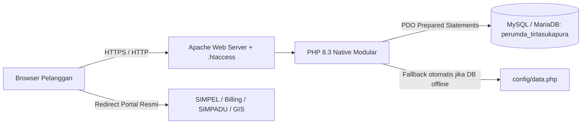
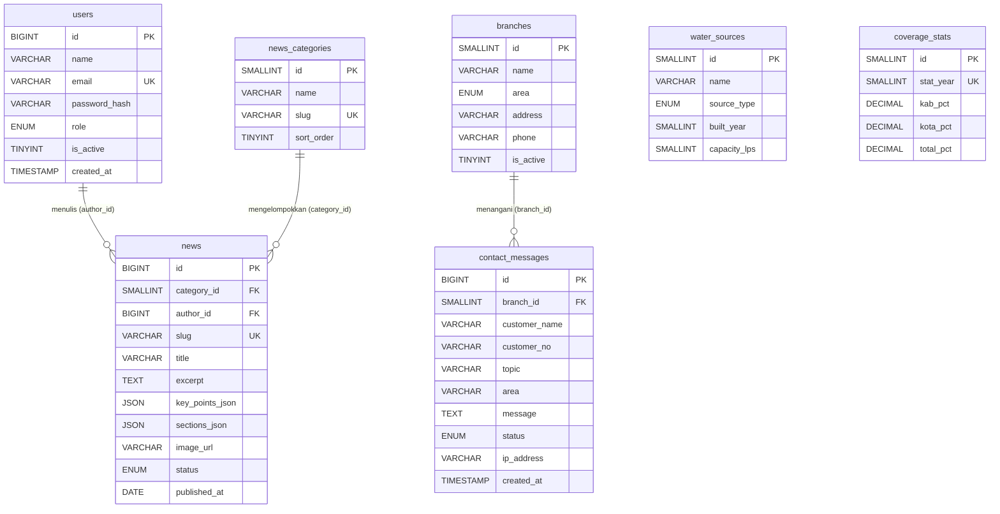

# PRD & System Design — Portal Perumda Air Minum Tirta Sukapura

## 1. Product Requirements Document (PRD)

### Tujuan
Mengganti tampilan portal lama berbasis CodeIgniter 3 (PHPMu) menjadi portal multi-halaman PHP 8.3 yang cepat, mudah dipelihara, aman dari celah web shell / SQL Injection, dan siap terindeks mesin pencari (SEO, AEO, GEO).

### Pengguna Utama
1. **Pelanggan & Calon Pelanggan (Warga Tasikmalaya)**
   - Mengecek tagihan air bulanan dan membayar lewat bank mitra.
   - Mendaftar sambungan baru melalui portal SIMPEL.
   - Melapor kebocoran pipa atau aliran mati dan memantau progres tiket.
   - Membaca informasi gangguan aliran, pengurasan reservoir, dan lokasi 17 cabang.
2. **Tim Humas & IT Kantor**
   - Mengelola data berita, daftar cabang, kapasitas sumber air, dan pesan pelanggan secara terstruktur di MySQL.
   - Menjaga kompatibilitas server kantor (Apache + PHP 8.3) tanpa ketergantungan build Node.js di server produksi.

### Ruang Lingkup Fitur
| Halaman / Modul | Fungsi Utama | Sumber Data |
| :--- | :--- | :--- |
| `index.php` | Hero, 6 akses cepat layanan, marquee mitra pembayaran, ringkasan profil, ruang berita, FAQ AEO | MySQL (`news`, `water_sources`) + config |
| `layanan.php` | 6 tautan portal digital, prosedur pelayanan, simulasi estimasi tarif, FAQ | Config + JSON-LD `HowTo` & `FAQPage` |
| `profil.php` | Visi & misi, sejarah 1925–kini, tabel 9 sumber air (513 L/dtk), cakupan layanan 2019–2023 | MySQL (`water_sources`, `coverage_stats`) |
| `berita.php` & `berita-detail.php` | Daftar berita dengan filter kategori + pencarian, halaman detail artikel + `NewsArticle` schema | MySQL (`news`, `news_categories`, `users`) |
| `kontak.php` & `api/contact-submit.php` | Info kantor pusat, Google Maps, form pesan (simpan MySQL + CSRF + opsi WhatsApp), direktori 17 cabang | MySQL (`branches`, `contact_messages`) |

---

## 2. System Design (Arsitektur)

### Lapisan Keamanan (Anti Web Shell & SQL Injection)
1. **Prepared Statements Wajib (`PDO::ATTR_EMULATE_PREPARES => false`):** Semua query baca/tulis memakai parameter binding (`?` / `:param`).
2. **Proteksi Folder Internal (`.htaccess`):** Akses HTTP langsung ke `config/`, `includes/`, `database/`, dan `docs/` diblokir (`403 Forbidden`).
3. **Blokir Eksekusi PHP di Folder Aset (`assets/.htaccess`):** Mencegah file `.php` atau web shell dijalankan jika suatu saat ada fitur upload gambar.
4. **CSRF Token & Output Escaping:** Form kontak memverifikasi token sesi (`hash_equals`) dan seluruh output HTML melewati `htmlspecialchars(..., ENT_QUOTES, 'UTF-8')`.

---

## 3. Entity Relationship Diagram (ERD — PK & FK)

---

## 4. SOP Update Versi PHP di Production

1. **Jadwal Maintenance Aman:** Pukul **22.00 – 02.00 WIB** atau akhir pekan **00.00 – 04.00 WIB**. Hindari tanggal **1–5** (awal bulan) dan **18–20** (jatuh tempo rekening air).
2. **Uji di Staging / Laragon:** Uji kode + dump database di versi PHP target (`8.3`) sampai nol `Fatal error` dan `Deprecated`.
3. **Backup Penuh:** Arsipkan source code dan dump MySQL (`mysqldump`) sebelum perubahan.
4. **Isolasi Multi-PHP (PHP-FPM / MultiPHP Manager):** Naikkan versi PHP hanya pada domain portal baru agar aplikasi internal lama (seperti CodeIgniter 2 di `dashboard_billing_tasik`) tetap berjalan di versi PHP-nya sendiri.
5. **Reload & Pantau Log:** Gunakan `apache2ctl configtest && systemctl reload apache2`, lalu pantau `error.log` minimal 15–30 menit. Siapkan rollback satu baris jika terjadi kegagalan.
